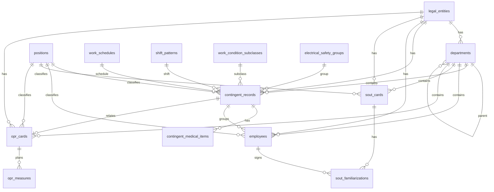

# DATA_MODEL

Модель данных первой версии. Решения этапа 0 утверждены (2026-10-22): СУБД — SQLite WAL через SQLAlchemy (D-002); идентификаторы — UUID v4 в `CHAR(36)`, генерируются приложением (D-012); должности — глобальный справочник (D-013); идентификация контингента — по D-004; история переводов — таблица `employment_history` (D-005). СНИЛС — строка (D-007).

## 1. Сущности

### 1.1. `legal_entities` — юридические лица

| Поле | Тип | Обяз. | Примечание |
|---|---|---|---|
| id | UUID | да | PK |
| full_name | string(500) | да | полное наименование |
| short_name | string(255) | нет | |
| inn | string(12) | нет | 10 или 12 цифр |
| kpp | string(9) | нет | 9 цифр |
| ogrn | string(15) | нет | 13 или 15 цифр |
| legal_address | text | нет | |
| actual_address | text | нет | |
| extra_info | text | нет | |
| status | enum(active, archived) | да | по умолчанию active |
| created_at | datetime | да | |
| updated_at | datetime | да | |

Ограничения: уникальность `(inn, kpp)` при заполненных значениях; уникальность `ogrn` при заполнении. Проверка контрольных сумм — на уровне приложения (предупреждение).

### 1.2. `departments` — подразделения

| Поле | Тип | Обяз. | Примечание |
|---|---|---|---|
| id | UUID | да | PK |
| legal_entity_id | UUID | да | FK → legal_entities |
| parent_id | UUID | нет | FK → departments |
| name | string(255) | да | |
| status | enum(active, archived) | да | |
| created_at, updated_at | datetime | да | |

Уникальность: `(legal_entity_id, parent_id, name)` с учётом NULL.

### 1.3. `positions` — должности

| Поле | Тип | Обяз. | Примечание |
|---|---|---|---|
| id | UUID | да | PK |
| name | string(255) | да | уникально по нормализованному значению (D-013) |
| normalized_name | string(255) | да | для проверки дубликатов, уникальный индекс |
| legal_entity_id | UUID | нет | NULL = глобальная должность; в v1 всегда NULL (D-013) |
| status | enum(active, archived) | да | |
| created_at, updated_at | datetime | да | |

Область действия — глобальный справочник (D-013 принято).

### 1.4. Справочники условий

- `work_schedules` — графики работы: id, name, status.
- `shift_patterns` — сменность: id, name, status.
- `work_condition_subclasses` — подклассы условий труда: id, code, name, status.
- `electrical_safety_groups` — группы по электробезопасности: id, name, status.

### 1.5. `contingent_records` — контингент

| Поле | Тип | Обяз. | Примечание |
|---|---|---|---|
| id | UUID | да | PK |
| legal_entity_id | UUID | да | FK → legal_entities |
| department_id | UUID | да | FK → departments |
| position_id | UUID | да | FK → positions |
| workplace_label | string(255) | нет | уточнение рабочего места |
| work_schedule_id | UUID | нет | FK → work_schedules |
| shift_pattern_id | UUID | нет | FK → shift_patterns |
| risk_card_number | string(100) | нет | номер карты ОПР |
| sout_card_number | string(100) | нет | номер карты СОУТ |
| work_condition_subclass_id | UUID | нет | FK → work_condition_subclasses |
| training_program | string(500) | нет | программа инструктажа |
| internship_program | string(500) | нет | программа стажировки |
| electrical_safety_group_id | UUID | нет | FK → electrical_safety_groups |
| status | enum(active, archived) | да | |
| created_at, updated_at | datetime | да | |

Проверка: `department.legal_entity_id = legal_entity_id`.

Идентификация записи — D-004 (принято): уникальное ограничение НЕ вводится; импорт идентифицирует кандидата по ключу `(legal_entity_id, department_id, position_id, workplace_label)` и требует подтверждения пользователем при неоднозначности. Индекс (не unique) по этим полям. Перспективная необязательная связь `workplace_id` (сущность «рабочее место») добавляется миграцией при появлении модулей СОУТ/ОПР.

### 1.6. `contingent_medical_items` — пункты приказов 29н/342н

| Поле | Тип | Обяз. | Примечание |
|---|---|---|---|
| id | UUID | да | PK |
| contingent_record_id | UUID | да | FK → contingent_records |
| order_type | enum(29н, 342н) | да | |
| item_number | string(50) | да | |
| note | string(255) | нет | |

Уникальность: `(contingent_record_id, order_type, item_number)`.

### 1.7. `employees` — работники

| Поле | Тип | Обяз. | Примечание |
|---|---|---|---|
| id | UUID | да | PK |
| legal_entity_id | UUID | да | FK → legal_entities |
| department_id | UUID | да | FK → departments |
| position_id | UUID | да | FK → positions |
| contingent_record_id | UUID | нет | FK → contingent_records; при неоднозначности выбора связь не устанавливается автоматически (D-004, FR-09) |
| last_name | string(100) | да | |
| first_name | string(100) | да | |
| middle_name | string(100) | нет | |
| hire_date | date | нет | проверка даты |
| birth_date | date | нет | проверка даты |
| snils | string(14) | нет | строка, формат XXX-XXX-XXX YY |
| status | enum(active, archived) | да | |
| created_at, updated_at | datetime | да | |

Ограничения: ФИО не является ключом. Уникальность СНИЛС в рамках одного юридического лица не гарантируется жёстко: возможны совпадения и внешние совместители; выдаётся предупреждение. Индексы: `(last_name, first_name)`, `snils`.

Проверки: подразделение и должность принадлежат тому же юридическому лицу; запись контингента принадлежит тому же юридическому лицу.

### 1.8. `attachments` — вложения (перспектива)

| Поле | Тип | Примечание |
|---|---|---|
| id | UUID | PK |
| entity_type | string | тип сущности |
| entity_id | UUID | идентификатор сущности |
| file_name | string | исходное имя |
| stored_path | string | путь в хранилище |
| mime_type | string | |
| size_bytes | integer | |
| checksum | string | |
| uploaded_at | datetime | |
| uploaded_by | string | |

Полиморфная связь без FK. В первой версии может не использоваться.

### 1.9. `audit_log` — журнал аудита

| Поле | Тип | Примечание |
|---|---|---|
| id | UUID | PK |
| entity_type | string | |
| entity_id | UUID | |
| action | enum(create, update, archive, restore, import) | |
| changed_at | datetime | |
| actor | string | пользователь или процесс |
| before_data | json | снимок до |
| after_data | json | снимок после |
| comment | text | |

Индекс: `(entity_type, entity_id, changed_at)`.

### 1.10. `schema_migrations`

| Поле | Тип |
|---|---|
| version | string PK |
| applied_at | datetime |
| description | string |

### 1.11. `module_registry` (опционально)

| Поле | Тип |
|---|---|
| module_id | string PK |
| enabled | boolean |
| settings | json |
| updated_at | datetime |

### 1.12. `employment_history` — история кадровых перемещений (D-005 принято)

| Поле | Тип | Обяз. | Примечание |
|---|---|---|---|
| id | UUID | да | PK |
| employee_id | UUID | да | FK → employees |
| start_date | date | нет | дата начала периода (дата приёма или перевода) |
| end_date | date | нет | NULL = текущий период |
| department_id | UUID | нет | FK → departments |
| position_id | UUID | нет | FK → positions |
| contingent_record_id | UUID | нет | FK → contingent_records |
| reason | string(255) | нет | приём, перевод, изменение контингента и т.п. |
| comment | text | нет | |
| created_at | datetime | да | |

При изменении подразделения/должности/контингента работника текущий период закрывается (`end_date`), создаётся новый; старая комбинация сохраняется. Исторические периоды не перезаписываются. Реализация — этап 4.

### 1.13. `users` (перспектива)

В первой версии не создаётся. Архитектура должна допустить её добавление без переделки основных сущностей.

### 1.14. `sout_cards` — карты СОУТ (Этап 6, 426-ФЗ)

Реализовано в `src/types.ts` (`SoutCard`) и `src/services/storage.ts` (ключ LocalStorage `saot_sout_cards`).

| Поле | Тип | Обяз. | Примечание |
|---|---|---|---|
| id | UUID | да | PK (D-012) |
| card_number | string(100) | да | номер карты СОУТ, уникален в пределах юрлица |
| legal_entity_id | UUID | да | FK → legal_entities |
| department_id | UUID | да | FK → departments |
| position_id | UUID | да | FK → positions |
| workplace_label | string | нет | уточнение рабочего места |
| is_analogous / analogous_basis | boolean / string | нет | признание аналогичным и основание |
| factors | json (массив `SoutHarmfulFactor`) | да | вредные/опасные производственные факторы с классами |
| final_class | string | да | итоговый класс условий труда (1, 2, 3.1–3.4, 4), авторасчёт по максимальному подклассу |
| employees_count / women_count / minors_count / disabled_count | int | да | численность занятых (с разбивкой) |
| guarantees | json (`SoutGuarantees`) | да | компенсации и гарантии по классу (ст. 7, 147 ТК РФ) |
| measurement_org / protocol_number | string | нет | лаборатория и протокол измерений |
| report_approved_at / expires_at | date | нет | утверждение отчёта КОУТ; плановая дата окончания (5 лет, ст. 8) |
| declaration_active / declaration_number | boolean / string | нет | декларация соответствия (ст. 11) |
| status | enum(`EntityStatus`) | да | active/archived (D-009) |
| created_at / updated_at | datetime | да | |

### 1.15. `sout_familiarizations` — ознакомления работников под роспись (Этап 6)

Ключ `saot_sout_familiarizations`. Поля: `id` (UUID PK), `sout_card_id` (FK → sout_cards), `employee_id` (FK → employees), `signed_at` (date, ст. 5 426-ФЗ), `comment`, `created_at`.

### 1.16. `opr_cards` — карты оценки профессиональных рисков (Этап 7, Приказ Минтруда 776н)

Реализовано в `src/types.ts` (`OprCard`, `OprHazard`) и `src/services/storage.ts` (ключ `saot_opr_cards`).

| Поле | Тип | Обяз. | Примечание |
|---|---|---|---|
| id | UUID | да | PK (D-012) |
| card_number | string(100) | да | номер карты ОПР («ОПР-001»), уникален в пределах юрлица |
| legal_entity_id / department_id / position_id | UUID | да | FK → legal_entities / departments / positions |
| contingent_record_id | UUID | нет | FK → contingent_records |
| workplace_label | string | нет | уточнение рабочего места |
| assessment_date | date | нет | дата оценки |
| assessment_method | string | да | «Матричный метод 5х5» / «Файна-Кинни» |
| commission_members | string | нет | состав комиссии |
| hazards | json (массив `OprHazard`) | да | идентифицированные опасности (каталог 776н — `DEFAULT_OPR_HAZARDS`) |
| overall_risk_score / overall_risk_level | int / enum(`RiskLevel`) | да | авторасчёт по максимуму баллов опасностей (D-016) |
| status | enum(`EntityStatus`) | да | active/archived (D-009) |
| created_at / updated_at | datetime | да | |

Структура `OprHazard`: `id`, `code` (шифр по каталогу 776н), `category`, `name`, `danger_source`, `severity` (1..5 — тяжесть последствий), `probability` (1..5 — вероятность), `risk_score` (= severity × probability, 1..25), `risk_level` (low <5, moderate 5–9, high 10–15, unacceptable ≥16), `existing_measures`, `recommended_measures`.

### 1.17. `opr_measures` — план мероприятий по снижению рисков (Этап 7)

Ключ `saot_opr_measures`. Поля: `id` (UUID PK), `opr_card_id` (FK → opr_cards), `hazard_id` (ссылка на опасность внутри карты), `measure_title` (обяз.), `deadline` (date), `responsible_person`, `status` (`planned` | `in_progress` | `completed`), `cost_estimate`, `comment`, `created_at`, `updated_at`.

## 2. Связи

Логическая цепочка: юридическое лицо → подразделение → должность и контингент → работники; карты СОУТ/ОПР привязаны к тройке (юрлицо, подразделение, должность) и опционально к записи контингента. Связи не обязательно один-к-одному. Проверка ссылочной целостности внешних ключей карт СОУТ/ОПР и мероприятий плана выполняется в `verifyDataIntegrity()` (`src/services/storage.ts`).

## 3. Правила архивирования

- связанные записи не удаляются каскадно;
- архивирование — через `status`;
- по умолчанию показываются активные записи;
- архивные доступны по фильтру;
- жёсткое удаление связанных записей запрещено;
- удаление юридического лица с связями заменяется архивированием или отдельной процедурой с проверкой.

## 4. Правила изменения схемы

- только через миграции;
- обратная совместимость с ранее сохранёнными данными;
- новые поля — типизированные;
- JSON не используется вместо основной структуры;
- при изменении полей обновляются шаблоны импорта/экспорта и документация.

## 5. Закрытые вопросы этапа 0

Открытых вопросов нет. Принято: D-002 (SQLite WAL через SQLAlchemy ORM, путь к PostgreSQL), D-004 (идентификация контингента без unique-ограничения, подтверждение при неоднозначности), D-005 (таблица `employment_history`), D-012 (UUID v4 в CHAR(36)), D-013 (глобальный справочник должностей). Версия схемы хранится в таблице Alembic (`alembic_version`); сущность `schema_migrations` (§1.10) остаётся как описание принципа — фактическая реализация на Alembic (D-006).